# code-galaxy

**Point it at your code. Get a galaxy back.**


*This repo's own galaxy, re-rendered on every push by the [GitHub Action](#keep-it-fresh-in-your-readme-github-action) below.*

```bash
npx code-galaxy .                          # writes galaxy.svg
npx code-galaxy . --png                    # also galaxy.png (1200×1200, still)
npx code-galaxy . --still                  # SVG without animation
npx code-galaxy github.com/facebook/react  # shallow clone to a temp dir, analyze, delete
npx code-galaxy . --json                   # every metric, no picture
```

| facebook/react | django/django |
|---|---|
|  |  |
| **vitejs/vite** | **psf/requests** |
|  |  |

It is not random art seeded by a hash. Every object in the picture is real code, and every visual property comes from a metric.

## How to read it

| You see | It is | Measured as |
|---|---|---|
| The star in the middle | The core module | Highest fan-in: most imports from other modules point at it |
| Star corona | How hard the core pulls | Grows with the core's fan-in |
| Planet | A module: each folder (or file) inside the main code folder | Area ∝ lines of code |
| Planet color | Language | Dominant language by lines (TypeScript, JavaScript, Python) |
| Orbit | Distance from the core | Each planet has its own orbit. Outward: import hops to the core first, then how many import links tie it to the zone inside it (more ties = closer, like gravity). Dashed = not linked to the core at all |
| Lit side of a planet | Faces the core | Direction only |
| Moon | A file in that module | Area ∝ lines. Inner shells = most-imported files |
| Craters | Complexity | Average cyclomatic complexity per function |
| Bands | Nesting | Average deepest nesting per file (weighted by lines) |
| Faint lines | Imports between modules | Thicker = more file→file import links |
| Light pulses along the lines | Import direction | Travel from importer to imported; more imports, more pulses |
| Moons circling | Fan-in rank | Kepler's law (period ∝ r^1.5): inner shells, the most-imported files, run fastest |
| Dark outer belt | Dead code | Files nothing imports and that aren't an entry point; each one drifts near its home planet |

The same code always gives the exact same picture (tested byte-for-byte).

The SVG is animated with real orbits: every planet circles the core at its own Kepler speed (period ∝ r^1.5), so inner planets overtake outer ones, and the import lines and pulses are redrawn every frame to stay attached. Orbits are spaced so planets never collide; moon clouds may pass through each other.

That needs JavaScript, which runs when the SVG is opened in a browser or inlined in a page. Where scripts are blocked (an `` tag, a GitHub README) the same file falls back to CSS + SMIL: the system turns as one body, moons still orbit and imports still pulse. Motion stops for viewers with reduced motion turned on. The PNG is a still frame.

### Which folder becomes the planets?

Most repos keep the bulk of their code in one folder (`packages/`, `src/`, `src/mylib/`). code-galaxy follows the folder holding more than half the code downward until no single folder dominates, and its contents become the planets. Code outside it becomes planets at the level where it branches off.

Tests, examples, scripts and config are drawn like any other code, but they don't pick the core or the orbits. Otherwise thousands of tests importing `react` would make `react` the core of the React repo (it's `shared`).

## Keep it fresh in your README (GitHub Action)

Add `.github/workflows/galaxy.yml` to your repo:

```yaml
name: Galaxy
on:
  push:
    branches: [main]
  workflow_dispatch:

permissions:
  contents: write

jobs:
  galaxy:
    runs-on: ubuntu-latest
    steps:
      - uses: actions/checkout@v4
      - uses: Rydenjesper/Code-Galaxy@main
```

Then put this in your README (swap in your owner/repo):

```markdown

```

Every push to `main` re-renders the galaxy and force-pushes it as the only file on the `galaxy` branch. Nothing is committed to `main`, so there are no commit loops and no history piling up. Options: `path` (folder to analyze), `branch` (default `galaxy`), `png: true` (also a still `galaxy.png`), `name` (legend title).

GitHub blocks scripts in images, so the README gets the fallback animation (the system turns as one body, moons orbit, imports pulse). The real orbits run when the SVG is opened in a browser from your own machine or a web page.

## Known limits (v0.1)

- JavaScript, TypeScript and Python only. Other files are ignored.
- Static imports only. Code loaded dynamically by name (Django's `import_module`, plugin registries) shows up as dead.
- "Lines of code" = non-blank lines, comments included.

## Repo layout

- `packages/core` (`@code-galaxy/core`): analysis and rendering. No Node-only APIs, so it runs in the browser too. Parsing uses `web-tree-sitter` (WASM); grammars ship in `packages/core/grammars`.
- `packages/cli` (`code-galaxy`): a thin shell that walks the folder (respecting `.gitignore`), clones GitHub URLs, and writes SVG/PNG/JSON (PNG via `resvg-js`).

```bash
npm install
npm test        # builds and runs the tests
node packages/cli/dist/index.js ~/some/repo --png
```

## Prior art

- **Gource:** animated git history (who touched what, when). It shows activity, not structure.
- **CodeCity:** a codebase as a 3D city, built as an analysis tool and not as a shareable image.
- **code_swarm:** commit activity visualization.

code-galaxy draws structure as shareable art: one command, one image made for a README or a post.

## License

MIT
